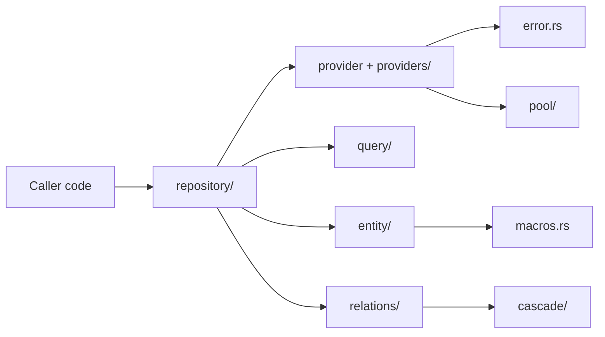

# nosql_orm — Architecture Overview

**Crate:** `nosql_orm` v0.9.0  
**Location:** `/mnt/external/Projects/nosql_orm/`  
**Test status:** 21 unit tests passing, 15 warnings, 0 TODO / FIXME markers — the cleanest of all six libraries.  

## 1. Mission

`nosql_orm` is a TypeORM-inspired ORM that delivers a **single, ergonomic API** across heterogeneous storage backends. Originally scoped to NoSQL (JSON files, MongoDB, Redis), the crate has expanded to include SQL providers (Postgres, MySQL, SQLite) under opt-in feature flags while keeping the unified `DatabaseProvider` trait as the integration surface. The trait was renamed from `Storage` to `DatabaseProvider` during the library-quality consolidation (see §6).

Primary responsibilities:

- A backend-agnostic CRUD + query interface (`DatabaseProvider`, `Repository`, `Filter`).
- A typed entity system (`Entity`, `EntityMeta`, `Validate`) with derive macros.
- Cross-cutting concerns: relations, cascading deletes, transactions, soft delete, search, indexes, CDC, observability, security.
- SQL dialect abstraction layered on top of the same trait — providers conform to `DatabaseProvider` regardless of backend.

## 2. Crate Map

The library is organised by concern. Top-level re-exports live in `src/lib.rs:50-75`.

### Module table

| Module | Path | Purpose |
| --- | --- | --- |
| `lib` | `src/lib.rs` (208) | Crate root; module declarations + `prelude`. |
| `provider` | `src/provider.rs` (158) | `DatabaseProvider`, `SchemaIntrospection`, `AdminCommands`, `TransactionControl` traits + `ProviderConfig`. |
| `providers` | `src/providers/mod.rs` (132) | Provider registry + submodules (`json`, `redis`, `mongo`, `sql`, `sync`). Feature-gated. |
| `repository` | `src/repository/mod.rs` (61) | Generic `Repository<E, P>` + `RelationRepository`, `QueryStream`, `SyncResult`. |
| `query` | `src/query/mod.rs` (19) | `Filter`, `QueryBuilder`, `Projection`, optimizer, hints, stats, zero-copy. |
| `entity` | `src/entity/mod.rs` (10) | `Entity` trait, `EntityMeta`, `FrontendProjection`, accessors, mutators. |
| `relations` | `src/relations/mod.rs` (16) | `RelationDef`, wrappers (`OneToMany`, `ManyToOne`, …), loader, registry, traversal. |
| `cascade` | `src/cascade/mod.rs` (199) | `CascadeManager` orchestrating hard / soft delete + restore across relations. |
| `pool` | `src/pool/mod.rs` (13) | Connection pools (`JsonPool`, `MongoPool`, `ReplicaPool`, `AdaptivePool`). |
| `sql` | `src/sql/mod.rs` (14) | SQL dialect types, prepared statements, query builder. |
| `error` | `src/error.rs` (96) | `OrmError` enum + `OrmResult<T>` alias. |
| `migrations` | `src/migrations/mod.rs` (3) | `Migration` trait, `JsonMigration`, `SqlMigration`, `MigrationRunner`. |
| `soft_delete` | `src/soft_delete.rs` (39) | `SoftDeletable` trait + extension methods. |
| `nosql_index` | `src/nosql_index/mod.rs` | Index manager. |
| `validators` | `src/validators/mod.rs` | Field validation trait + built-in validators. |
| `observability` | `src/observability/mod.rs` (13) | Metrics, circuit breaker, rate limiter, telemetry. |
| `logging` | `src/logging/mod.rs` | Query logger, file-backed query logger. |
| `security` | `src/security/mod.rs` (8) | Audit, encryption, query allowlist, row-level security. |
| `cli` | `src/cli/mod.rs` | `commands`, `migrator`, `seeder`. |
| `data_engineering` | `src/data_engineering/mod.rs` (10) | ETL, import/export, replication, schema evolution. |
| `cdc` | `src/cdc/mod.rs` | Change data capture, change stream, audit, sync. |
| `graphql` | `src/graphql/mod.rs` (10) | GraphQL schema, resolver, types. |
| `subscription` | `src/subscription/mod.rs` | Pub/sub (Publisher / Subscription / Topic). |
| `embedded` | `src/embedded/mod.rs` | Embedded documents. |
| `inheritance` | `src/inheritance/mod.rs` | Single-table inheritance + discriminator. |
| `lazy` | `src/lazy/mod.rs` | `Lazy`, `LazyLoader`, `LazyMany`, `LazyRelation`. |
| `aggregation` | `src/aggregation/mod.rs` (7) | Mongo-style aggregation pipelines. |
| `search` | `src/search/mod.rs` | Full-text search. |
| `constraints` | `src/constraints/mod.rs` | Column + index constraints. |
| `events` | `src/events/mod.rs` | `EntityEvents`, `EntityEventListener`. |
| `macros` | `src/macros.rs` (98) | Convenience filter constructors (`eq_filter`, `and_filter`, …). |
| `model_helper` | `src/model_helper.rs` (31) | `ModelHelper` derive + `WithValidation`. |
| `field_meta` | `src/field_meta.rs` (159) | Field-level metadata for the entity layer. |
| `timestamps` | `src/timestamps.rs` (119) | `Timestamps` + `apply_timestamps` helper. |
| `transaction` | `src/transaction.rs` (100) | `Transaction` + `TransactionState`. |
| `utils` | `src/utils.rs` (60) | `compare_values`, `generate_id`, `get_document_id`. |
| `admin_types` | `src/admin_types.rs` (95) | Cross-cutting admin DTOs (`CollectionMeta`, `PoolStats`, …). |
| `providers/json` | `src/providers/json.rs` (760) | JSON-file storage — default backend. |
| `providers/redis` | `src/providers/redis.rs` (469) | Redis backend. |
| `providers/mongo` | `src/providers/mongo/mod.rs` (528) | MongoDB backend + filter/convert/indexes. |
| `providers/sql` | `src/providers/sql/{postgres,mysql,sqlite,common,row,utils}.rs` | SQL backends — 681/700/744 LOC. |

The `prelude` module (`src/lib.rs:107-208`) re-exports the public surface for typical usage.

## 3. Public API Surface

What callers import and depend on:

### Traits (the core contract)

| Trait | File:Line | Role |
| --- | --- | --- |
| `DatabaseProvider` | `src/provider.rs:30` | Unified CRUD + index + aggregate + health API across all backends. |
| `SchemaIntrospection` | `src/provider.rs:106` | List/describe collections, indexes, database names. |
| `AdminCommands` | `src/provider.rs:120` | Raw SQL, create/drop/rename collection. |
| `TransactionControl` | `src/provider.rs:128` | Begin/commit/rollback + `TransactionId`. |
| `Entity` | `src/entity/inner.rs:25` | Bound between a Rust struct and a collection. |
| `FrontendProjection` | `src/entity/inner.rs:14` | Field filtering for client payloads. |
| `SoftDeletable` | `src/soft_delete.rs` | Marks an entity as soft-deletable. |
| `WithRelations` | `src/relations/types.rs:7` | Declares the entity's relation graph. |
| `Migration
` | `src/migrations/migration.rs:17` | Up/down migration contract. |
| `Validate` | (derive macro from `nosql_orm_derive`) | Field-level validation entry point. |

### Concrete providers (re-exported under feature flags)

- `JsonProvider` — `src/providers/json.rs:104`, default-on (`json` feature, also enabled in the default set).
- `MongoProvider` — `src/providers/mongo/mod.rs` under `mongo` feature.
- `RedisProvider` — `src/providers/redis.rs` under `redis` feature.
- `PostgresProvider` — `src/providers/sql/postgres.rs` under `sql-postgres` feature.
- `SqliteProvider` — `src/providers/sql/sqlite.rs` under `sql-sqlite` feature.
- `MySqlProvider` — `src/providers/sql/mysql.rs` under `sql-mysql` feature.
- `FallbackProvider<P1, P2>` — `src/providers/mod.rs:8`. Wraps primary + fallback providers with `find_with_fallback` / `find_all_with_fallback`.
- Stubs (`ClickHouseProvider`, `CockroachProvider`, `DynamoProvider`) declared behind feature flags but not yet implemented.

### Repository

- `Repository<E, P>` — `src/repository/mod.rs:30` (with `where E: Entity, P: DatabaseProvider`).
  - CRUD: `insert`, `update`, `save`, `save_from_value`, `update_from_value`, `patch`, `delete`, `remove`, `delete_many`, `update_many`, `insert_many`, `upsert_many`.
  - Find: `find_by_id`, `get_by_id`, `find_all`, `find_all_including_deleted`, `count`, `exists`, `find_for_frontend`, `find_by_id_for_frontend`, `find_by_id_with_timeout`, `find_all_with_timeout`, `count_with_timeout`.
  - Query: `query` (`src/repository/query.rs`), `query_stream` (`QueryStream`), `with_relations` (`src/repository/relations.rs`).
  - Indexes: `create_index`, `drop_index`, `list_indexes` (`src/repository/indexes.rs`).
  - Fast-path: `src/repository/fast_path.rs`.

### Query

- `Filter` enum (`src/query/filter.rs:9`) — 18 variants: `Eq`, `Ne`, `Gt`, `Gte`, `Lt`, `Lte`, `In`, `NotIn`, `ArrayContains`, `Contains`, `StartsWith`, `EndsWith`, `Like`, `IsNull`, `IsNotNull`, `Between`, `And`, `Or`, `Not`. Each variant implements `matches(&self, doc: &Value) -> bool`.
- `Filter::from_json(&Value)` (`src/query/filter.rs:84`) — JSON descriptor → `Filter` (Mongo-style operators).
- `QueryBuilder`, `Projection`, `QueryOptimizer`, `QueryAnalyzer`, `IndexRecommender`, `QueryStatistics` (all under `src/query/`).

### Macros (`src/macros.rs:1`)

`eq_filter`, `ne_filter`, `gt_filter`, `gte_filter`, `lt_filter`, `lte_filter`, `in_filter`, `not_filter`, `and_filter`, `or_filter`, `is_null_filter`, `is_not_null_filter` — short-hand constructors for `Filter`.

### Errors

- `OrmError` (`src/error.rs:6`) — 22 variants including feature-gated `Mongo`, `Redis`.
- `OrmResult<T>` alias (`src/error.rs:96`).
- Helpers `map_err_connection`, `map_err_query` (`src/error.rs:78-86`).

### Misc

- `ProviderConfig` (`src/provider.rs:9`), `EntityMeta` (`src/entity/inner.rs:7`).
- `CascadeManager` (`src/cascade/mod.rs:11`).
- `Transaction` / `TransactionState` (`src/transaction.rs`).
- `MigrationRunner` (`src/migrations/runner.rs`).

## 4. Integration Points

The crate is depended on by `entity-runtime` (the dynamic repository wrapper). Apps integrate via `use nosql_orm::prelude::*;` (`src/lib.rs:107`) or selectively import providers and traits.

Typical integration:

1. Implement `Entity` on the domain struct.
2. Construct the provider (`JsonProvider::new("./data").await?`).
3. Build a `Repository::<MyEntity, _>::new(provider)`.
4. Call `repo.save(entity)`, `repo.find_by_id(id)`, `repo.find_all()` …

The `prelude` module brings everything needed for this loop — typically — getters, builders, validators, the entity, the provider trait, and the repository.

## 5. Tests

- **Library tests:** `cargo test --manifest-path nosql_orm/Cargo.toml --lib` — 21 passing.
- **Examples:** four binaries gated on features (`json_example`, `mongo_example`, `sql_example`, `sql_postgres_example`, `sql_mysql_example`) declared in `Cargo.toml:62-78`.
- **Dev-deps:** `tempfile`, `proptest`, `tracing-test`, `parking_lot` (`Cargo.toml:80-85`).

## 6. Migration History — Trait rename (`Storage` → `DatabaseProvider`)

During the library-quality consolidation, the old `Storage` trait was renamed to `DatabaseProvider`. Historical callers and docs referenced `Storage`. After the rename:

- `src/provider.rs:30` declares `DatabaseProvider` as the canonical name.
- The four sub-traits (`SchemaIntrospection`, `AdminCommands`, `TransactionControl`) keep their names.
- All providers (JSON, Mongo, Redis, Postgres, MySQL) were amended.
- New callers should import `DatabaseProvider`. References to `Storage` in older external integrations need updating; nothing in the workspace retains `Storage` references after consolidation.

## 7. Known Quality Issues

| Issue | Severity | Detail |
| --- | --- | --- |
| 0 TODO / FIXME markers | — | Library is the cleanest in the workspace. |
| 15 compile warnings | low | All minor — mostly unused imports across the SQL submodules. |
| 6 modules >100 LOC untested | medium | `sql/postgres.rs`, `sql/mysql.rs`, `sql/sqlite.rs`, `redis.rs`, `mongo/mod.rs`, `data_engineering/import_export.rs`. Three SQL providers have `#[ignore]` tests requiring live DBs; Redis/Mongo same. |
| Backends with feature gates only | low | `ClickHouseProvider`, `CockroachProvider`, `DynamoProvider` stubs. |

The plan's Phase B3 adds trait-conformance `#[ignore]` tests for the six untested modules and a JSON/CSV roundtrip test for `data_engineering/import_export.rs`.

## 8. Dependency Footprint

- **Always-on:** `serde`, `serde_json`, `async-trait`, `thiserror`, `uuid`, `chrono`, `tokio`, `deadpool`, `regex`, `rand`, `base64`, `ring`, `tracing`, `nosql_orm_derive`.
- **Feature-gated:** `mongodb`, `redis`, `tokio-postgres`, `deadpool-postgres`, `mysql_async`, `rusqlite`, `opentelemetry`.
- **Dev:** `tempfile`, `proptest`, `tracing-test`, `parking_lot`.

## 9. Further Reading

- `src/lib.rs` — top-level docs and `prelude`.
- `README.md` — original overview.
- `docs/MODULE.md` — per-module breakdown.
- `plan.md` — historical planning document.
- `docs/00-table-of-contents.md` and friends — original narrative docs (kept for reference; canonical reference is now `MODULE.md`).